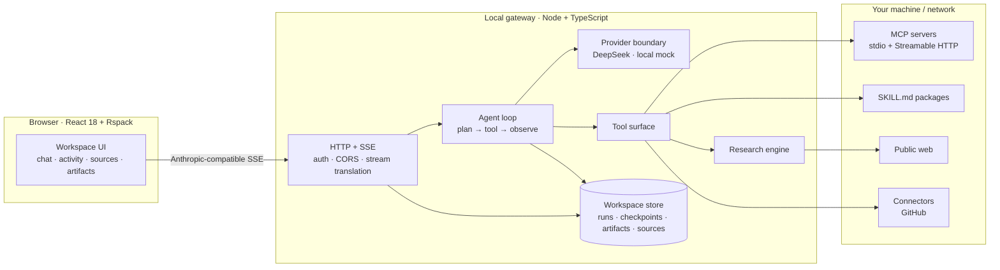
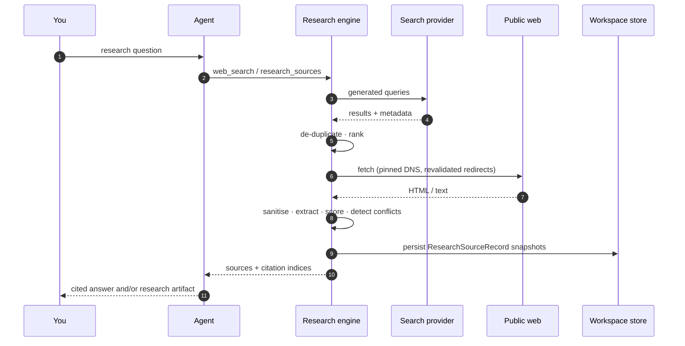

<div align="center">



<br />


<br /><br />

<a href="LICENSE"></a>
<a href="#quick-start"></a>
<a href="src/"></a>
<a href="docs/ARCHITECTURE.md"></a>
<a href="#web-research-engine"></a>
<a href="ui/"></a>

<br /><br />

<p>
  <b>Your key. Your machine. Real tools, real approvals, real citations.</b><br />
  <sub>An open-source agent runtime and workspace that gives DeepSeek the tooling it deserves —<br />without pretending mock output is the internet.</sub>
</p>

</div>

---

<details open>
<summary><b>Contents</b></summary>

<br />

<table>
<tr>
<td valign="top" width="50%">

<ul>
<li><a href="#why-this-project">Why this project</a></li>
<li><a href="#what-you-get">What you get</a></li>
<li><a href="#architecture">Architecture</a></li>
<li><a href="#quick-start">Quick start</a></li>
<li><a href="#web-research-engine">Web research engine</a></li>
<li><a href="#durable-runs-and-artifacts">Durable runs and artifacts</a></li>
<li><a href="#configuration">Configuration</a></li>
</ul>

</td>
<td valign="top" width="50%">

<ul>
<li><a href="#command-reference">Command reference</a></li>
<li><a href="#testing">Testing</a></li>
<li><a href="#project-structure">Project structure</a></li>
<li><a href="#security-model">Security model</a></li>
<li><a href="#roadmap">Roadmap</a></li>
<li><a href="#faq">FAQ</a></li>
<li><a href="#contributing">Contributing</a></li>
<li><a href="#license">License</a></li>
</ul>

</td>
</tr>
</table>

</details>

---

## Why this project

DeepSeek's chat UI is excellent at conversation. It was never designed to run MCP servers, load skills, pause for an approval, survive a restart halfway through a tool call, or prove where a sentence came from.

**deepseek-ui is the missing execution layer.** A local gateway owns the things a browser must not: provider keys, stdio MCP processes, filesystem access, permission decisions, retrieval, durable checkpoints, and artifact storage. The React workspace is the cockpit — not the trust boundary.

> [!NOTE]
> **Local-first, provider-aware.** The production provider is DeepSeek. A fully deterministic **Local mock** model and a local research corpus make the entire product demoable with **zero API keys and no network access**. Every mock result is labelled as mock in the tool payload, the streamed metadata, and the UI.

---

## What you get

| Capability | What is actually implemented |
| :--- | :--- |
| **Agent runtime** | Plan → tool → observe loop with iteration caps, context compaction, and verbatim `reasoning_content` round-trip for DeepSeek thinking mode with tools. |
| **MCP, native** | Trusted stdio and explicitly configured Streamable HTTP servers; namespaced `server__tool` names; schema validation; per-server timeouts, retries, and read-only concurrency hints. |
| **Skills** | `SKILL.md` discovery and progressive loading, plus managed skill packages you can install, inspect, edit, and remove without executing package scripts. |
| **Permissions & approvals** | Allow / ask / deny decided in code, never by the model. Durable approval records carry immutable operation snapshots, schema fingerprints, hashes, and expiry. |
| **Durable runs** | Versioned, integrity-hashed checkpoints; owner-scoped run leases; resume without replaying side effects; completed tool journal entries are reused. |
| **Artifacts workspace** | Persistent, append-only versions of markdown, code, HTML, Mermaid, JSON, data, and text. Edit, download, restore history, and keep per-version research source references. |
| **Web research** | Four read-only tools — `web_search`, `web_fetch`, `web_extract`, `research_sources` — backed by a provider interface, SSRF-safe fetcher, sanitising extractor, de-duplication, conflict detection, and citations that resolve to real retrieved snapshots. |
| **Connectors** | GitHub repository listing, file reads, and approval-gated issue creation; Google Drive and Notion are explicit placeholders, not fake “connected” integrations. Connector tokens are AES-256-GCM encrypted server-side. |
| **Local workspace** | Atomic, serialised JSON persistence at `.deepseek-ui/workspace.json` with owner-scoped conversations, runs, events, approvals, projects, files, artifacts, sources, and checkpoints. |

---

## Architecture



**The boundaries are deliberate:**

- **Browser** — conversation state, rendering, settings. It never spawns processes and never holds connector secrets.
- **Gateway** — authentication, CORS, body limits, provider calls, MCP processes, entitlement checks, checkpoints, and streaming translation.
- **Policy** — `src/permissions.ts` + durable approvals. The UI can request; only the gateway authorises.
- **Persistence** — `PersistenceAdapter`; the atomic JSON adapter can be replaced without touching the agent or gateway contracts.
- **Research** — `SearchProvider` + safe fetcher + extractor. Page content is untrusted evidence, never instructions.

> [!TIP]
> A browser cannot spawn stdio MCP servers or safely hold a vault of connector tokens. That single constraint explains the whole architecture: **the gateway is the seam**.

---

## Quick start

**Prerequisites**

| Requirement | Notes |
| :--- | :--- |
| Node.js **20+** (22.12+ recommended) | Gateway/runtime. The bundled UI follows the upstream requirement of Node 22.12+. |
| **pnpm** | For `ui/`. `npm` is fine for the gateway and tests. |
| DeepSeek API key | Optional for the UI demo: enter it in **Settings** and it is sent per request. Required for the CLI harness and live model output. |
| Tavily API key | Optional. Without it, research uses the labelled local fixture corpus. |

### 1 · Start the gateway

```bash
git clone https://github.com/NISTALTALSON/deepseek-ui.git
cd deepseek-ui
npm install
npm run gateway
# gateway listening on http://127.0.0.1:8787
```

### 2 · Start the workspace UI

In a second terminal:

```bash
cd ui
pnpm install
pnpm dev
```

Open **http://localhost:8090**, open **Settings**, and paste your DeepSeek API key. The development build already points at `http://127.0.0.1:8787`.



<sub>Illustrative session. Real sessions label the active research provider; mock results never claim to be internet results.</sub>

### 3 · Try it without any keys

Set the gateway to mock mode in `deepseek-ui.config.json`:

```json
{ "provider": "mock" }
```

Then choose **Local mock** as the model in the UI. The agent, tools, approvals, checkpoints, artifacts, and research workflow all run locally. Research returns deterministic fixture pages, clearly marked **Local mock**.

### Live web research

The Tavily key belongs to the gateway process:

```bash
# macOS / Linux
TAVILY_API_KEY=tvly-... npm run gateway

# PowerShell
$env:TAVILY_API_KEY = "tvly-..."; npm run gateway
```

Or set `research.apiKey` in `deepseek-ui.config.json` for a local-only setup (never commit it).

> [!TIP]
> `.env` is **not** read automatically. Export variables in your shell, or launch the gateway with Node's env loader:
> `node --env-file=.env --import tsx src/gateway.ts`.
> If `NODE_ENV=production` is set globally, npm and pnpm may skip devDependencies — use `NODE_ENV=development` while installing.

Point the UI at another compatible API with `DEEPSEEK_UI_API_ORIGIN` (for example `http://127.0.0.1:9000`) when running `pnpm dev` or `pnpm build`.

---

## Web research engine

The research layer is a real retrieval pipeline, not a prompt trick. It is provider-independent, bounded, and built so that a fetched page can never become a trusted instruction.



### The tools

| Tool | Permission class | What it does |
| :--- | :--- | :--- |
| `web_search` | `read-only` | Queries the configured provider. Returns title, URL, domain, snippet, publication date, retrieval timestamp, provider, mock flag, and a stable `citationIndex`. |
| `web_fetch` | `read-only` | Validates and retrieves one public page, extracts readable text, records the snapshot, and returns extraction status. |
| `web_extract` | `read-only` | Same safe retrieval, but returns the passages most relevant to a query plus the extracted text. |
| `research_sources` | `read-only` | `action=list` returns the conversation’s sources. `action=run` executes the bounded multi-step workflow: query generation, searches, de-duplication, ranking, fetch/extract, relevance, numeric-claim conflict detection, and an extractive brief. |
| `artifact_create` / `artifact_update` | `external-side-effect` · **approval** | Create or version a research report and attach the `sourceIds` behind it. |

### Security is enforced below the prompt

| Threat | Control |
| :--- | :--- |
| SSRF via arbitrary URLs | HTTP(S) only, no URL credentials, ports 80/443 only; localhost/internal names and private, loopback, link-local, CGNAT, multicast, reserved, documentation, IPv4-mapped IPv6, and NAT64 ranges rejected. |
| DNS rebinding | Resolve once, reject if **any** answer is non-public, then pin the validated address for the socket. |
| Redirect traps | Manual hop-by-hop following, every target revalidated, four-hop cap, HTTPS→HTTP downgrade refused, credentials and blocked hosts rejected. |
| Resource exhaustion | 2 MB response cap, 15 s timeout, per-host serialisation, bounded page concurrency, and a per-run research tool budget. |
| Remote code execution | Page scripts are never executed. Extraction removes scripts, styles, comments, hidden elements, forms, and navigation before producing plain text. |
| Prompt injection | Retrieved text is wrapped as **untrusted evidence**; the research system prompt forbids following page instructions or inventing URLs, dates, quotes, and citations. |
| Fake citations | Citations resolve only against persisted snapshots. Unknown `[citation:N]` markers are dropped by the renderer. |
| Mock masquerading as live data | The provider reports `isMock`; tools include a `MOCK SEARCH` notice; SSE blocks carry `is_mock`; source cards and answer summaries label local fixtures. |

### Citations that survive the conversation

Every retrieved source is persisted as an owner-scoped snapshot:

```jsonc
{
  "id": "source-uuid",
  "citationIndex": 1,
  "title": "Quantum error correction reaches a practical milestone",
  "url": "https://www.example-science.org/quantum/error-correction",
  "canonicalUrl": "https://www.example-science.org/quantum/error-correction",
  "domain": "www.example-science.org",
  "snippet": "Researchers report a 256-qubit error-corrected processor…",
  "retrievedAt": "2026-02-03T04:05:06.000Z",
  "publishedAt": "2025-03-11T09:00:00.000Z",
  "excerpt": "The team reported a 256-qubit error-corrected processor…",
  "content": "Plain, sanitized page text…",
  "provider": "local-mock",
  "isMock": true,
  "status": "extracted",
  "metadata": { "contentType": "text/html", "contentLength": 612 }
}
```

- Re-fetching the same canonical URL **enriches** the snapshot without renumbering its citation.
- The activity panel shows queries, discovered sources, pages inspected, extraction status, and completion.
- Clicking a source opens its extracted text, timestamps, provider, and mock badge **without leaving the conversation**.
- Artifacts store `sourceIds` in metadata **and in each version**, and the artifact panel lists them.

> [!IMPORTANT]
> Mock mode never performs an internet search. The deterministic corpus exists for development, tests, and offline demos — and every surface says so.

### Research configuration

```jsonc
{
  "research": {
    "provider": "auto",       // "auto" | "mock" | "tavily"
    "maxResults": 8,
    "maxPages": 5,
    "respectRobots": true
  }
}
```

`auto` selects Tavily when `TAVILY_API_KEY` (or `research.apiKey`) is configured and otherwise falls back to the local corpus. A requested provider with missing credentials is reported as **unavailable** — never silently replaced.

Research endpoints: `GET /research/status`, `GET /research/sources?conversationId=…`, `GET /research/sources/:id`, `POST /research/search`, `POST /research/run`.

---

## Durable runs and artifacts

A tool call is not complete when the model emits it. It becomes a durable operation:

1. **Proposed** — a checkpoint records the pending call and iteration state.
2. **Policy** — allow, ask, or deny is decided in code; an approval record is stored with a hash of the operation.
3. **Executed** — the tool journal records start, then completion (or an ambiguous outcome that must be reconciled).
4. **Checkpointed** — normalized messages, tool results, provider/model configuration, phase, sequence, and an integrity hash are persisted.
5. **Resumable** — a restarted gateway can resume a paused run from the latest checkpoint without replaying completed side effects.

<details>
<summary><b>Checkpoint phases</b></summary>

<br />

`initialized` · `awaiting_model` · `model_response_received` · `tool_proposed` · `awaiting_approval` · `tool_ready` · `tool_running` · `tool_result_persisted` · `awaiting_model_continuation` · `paused` · `completed` · `failed` · `requires_reconciliation` · `cancelled`

Recovery endpoints: `GET /runs/:id/checkpoint`, `/checkpoint-history`, `/recovery`, `/resume`; replayable events are available at `GET /runs/:id/events` with `Last-Event-ID`.

</details>

**Artifacts** are append-only. `artifact_update` creates version *N+1*; restore creates a new version rather than rewriting history. Reports can be edited in the workspace panel and downloaded from `/artifacts/:id/download`. Research source ids attached to a version remain visible in the panel.

---

## Configuration

| Variable | Default | Purpose |
| :--- | :--- | :--- |
| `DEEPSEEK_API_KEY` | — | Optional for the UI (key can be supplied per request); required for the terminal harness and server-side provider calls. |
| `DEEPSEEK_BASE_URL` | `https://api.deepseek.com` | Provider base URL. |
| `TAVILY_API_KEY` | — | Live web research. Without it: labelled local fixtures. |
| `RESEARCH_PROVIDER` | `auto` | `auto` · `mock` · `tavily`. |
| `GATEWAY_API_KEY` | — | When set, the gateway requires this key on every request. |
| `GATEWAY_OWNER` | — | Trusted owner identity for authenticated deployments and connectors. |
| `CREDENTIAL_ENCRYPTION_KEY` | — | AES-256-GCM key for connector credentials; no plaintext fallback. |
| `GITHUB_OAUTH_CLIENT_ID` / `_SECRET` / `GITHUB_OAUTH_REDIRECT_URI` | — | GitHub connector OAuth. |
| `DEEPSEEK_UI_API_ORIGIN` | dev `http://127.0.0.1:8787` · prod `https://api.deepseek.com` | API origin injected into the UI build. |

A custom gateway policy replaces the built-in defaults, so it must allow the tools it needs:

```jsonc
{
  "provider": "deepseek",
  "port": 8787,
  "research": { "provider": "auto", "maxPages": 5 },
  "policy": {
    "rules": [
      { "tool": "knowledge_search", "decision": "allow" },
      { "tool": "web_search", "decision": "allow" },
      { "tool": "web_fetch", "decision": "allow" },
      { "tool": "web_extract", "decision": "allow" },
      { "tool": "research_sources", "decision": "allow" },
      { "tool": "artifact_create", "decision": "ask" },
      { "tool": "artifact_update", "decision": "ask" }
    ],
    "default": "deny"
  }
}
```

> [!WARNING]
> Keep secrets in environment variables or the OS keychain. `deepseek-ui.config.json` is not ignored by git; never commit provider or connector credentials.

State lives in `.deepseek-ui/workspace.json` (override with `dataFile`) and uploaded file content under the configured files root.

---

## Command reference

| Command | What it does |
| :--- | :--- |
| `npm run gateway` | Start the local gateway (`http://127.0.0.1:8787` by default). |
| `npm run dev` | Minimal terminal harness (requires `DEEPSEEK_API_KEY`). |
| `npm test` | Root test suite (`node:test` via `tsx`). |
| `npm run typecheck` | TypeScript check for the gateway, runtime, and tests. |
| `cd ui && pnpm dev` | Workspace UI on `http://localhost:8090`. |
| `cd ui && pnpm type` | UI TypeScript check. |
| `cd ui && pnpm lint` | oxlint across `ui/src`. |
| `cd ui && pnpm build` | Production Rspack build into `ui/dist`. |

---

## Testing

```bash
npm test
npm run typecheck
cd ui && pnpm type && pnpm lint && pnpm build
```

The suite currently contains **63 tests**:

| Suite | Coverage |
| :--- | :--- |
| `test/core.test.ts` | Persistence, run events, approvals, checkpoints, MCP URL safety, skills, permissions, gateway auth, projects/files/knowledge. |
| `test/research-core.test.ts` | SSRF and redirect rejection, DNS pinning, size/time limits, robots.txt, extraction sanitisation, mock determinism, Tavily mapping, provider resolution. |
| `test/research-engine.test.ts` | Query generation, de-duplication, bounded concurrency, citation-stable persistence, workflow conflicts, tool budgets, snapshot and artifact source references across reloads. |
| `test/research-gateway.test.ts` | End-to-end SSE research runs, approval-gated artifact creation with source ids, checkpoint resume without re-execution, workflow source blocks, unconfigured-provider honesty. |

Core research tests require **no paid credentials**. Live-provider behaviour is exercised through deterministic transport stubs.

---

## Project structure

```text
deepseek-ui/
├── src/
│   ├── gateway.ts          HTTP + SSE, approvals, run recovery, research endpoints
│   ├── agent.ts            plan → tool → observe loop, compaction, tool dispatch
│   ├── persistence.ts      atomic workspace store, checkpoints, artifacts, sources
│   ├── deepseek.ts         DeepSeek client with reasoning round-trip
│   ├── provider.ts         ModelProvider boundary + local mock
│   ├── mcp.ts              stdio and Streamable HTTP MCP hub
│   ├── skills.ts           SKILL.md registry and managed packages
│   ├── permissions.ts      allow / ask / deny policy
│   ├── connectors.ts       GitHub connector, OAuth/PKCE, capabilities
│   ├── credentials.ts      AES-256-GCM credential encryption
│   ├── knowledge.ts        uploads, extraction, chunking, keyword retrieval
│   └── research/
│       ├── types.ts        SearchProvider, sources, activity, limits
│       ├── search.ts       provider resolution and availability
│       ├── providers/      Tavily adapter + deterministic local corpus
│       ├── url-safety.ts   SSRF/DNS/redirect validation and pinning
│       ├── fetcher.ts      size/time-bounded, robots-aware retrieval
│       ├── extract.ts      plain-text metadata extraction and sanitisation
│       ├── engine.ts       workflow, dedupe, ranking, conflicts, briefs
│       └── tools.ts        read-only agent tool surface
├── ui/                     React 18 + Rspack workspace (MIT, vendored upstream)
├── test/                   node:test suites
├── docs/                   architecture, implementation report, SVG assets
├── skills/                 example SKILL.md
└── deepseek-ui.config.example.json
```

---

## Security model

> [!IMPORTANT]
> The gateway is the security and execution boundary. UI selection is never an authorization grant.

- **Approvals are durable, not modal theatre.** Each record stores the exact operation, argument hash, schema fingerprint, permission class, expiry, and compare-and-set decision. Side effects wait for a real decision.
- **Recovery never auto-replays ambiguity.** Running or ambiguous external operations pause for reconciliation; completed journal entries are reused.
- **Credentials stay server-side.** Connector tokens are encrypted with AES-256-GCM and never enter checkpoints, API responses, or tool metadata. The browser never receives them.
- **Retrieved content is data.** Research pages are untrusted; the agent’s tool observations are wrapped accordingly and cannot alter system policy.
- **MCP remote endpoints are constrained.** HTTPS only, no inline credentials, public-address-only resolution, no redirects, and per-server headers.
- **Mock is never disguised.** Local fixtures are labelled at every layer where a user or model could mistake them for live results.

Found a vulnerability? Please open a private security advisory through the repository’s **Security** tab rather than a public issue.

---

## Roadmap

- [x] Provider boundary with a labelled local mock
- [x] MCP tools, skills, permissions, and structured streaming
- [x] Durable runs, approvals, checkpoints, and resume
- [x] Persistent projects, files, artifacts, and knowledge search
- [x] Secure connector foundation with encrypted credentials
- [x] Provider-independent web research with citations and research artifacts
- [ ] Additional search adapters (Brave, Exa, SearXNG)
- [ ] Embedding re-ranking and a cross-conversation source library
- [ ] JavaScript-rendered retrieval and PDF extraction in the research pipeline
- [ ] Plugin manifest with one-step skill + MCP installation
- [ ] Live request/cost meter and cache-aware context manager
- [ ] Desktop packaging

---

## FAQ

<details>
<summary><b>Does this really work without any API keys?</b></summary>

<br />

Yes. Set `"provider": "mock"` in the gateway config and choose **Local mock** in the UI. The agent loop, tools, approvals, checkpoints, artifacts, and the research workflow all run locally against deterministic fixtures. Nothing claims to be a live model or a live search.

</details>

<details>
<summary><b>Is the mock search a real internet search?</b></summary>

<br />

No. It is a local fixture corpus. The tool payload, SSE metadata, source cards, and answer summary all label it. Configure `TAVILY_API_KEY` for live retrieval; `auto` falls back to mock only when no key exists.

</details>

<details>
<summary><b>Where is my data stored?</b></summary>

<br />

In `.deepseek-ui/workspace.json` by default (override with `dataFile`), plus uploaded file content under the configured files root. Conversation storage in the browser is local. There is no hosted account or sync layer.

</details>

<details>
<summary><b>Where is my API key kept?</b></summary>

<br />

The UI keeps the DeepSeek key in your browser’s local settings and sends it per request; the gateway does not persist it in the workspace store. Connector credentials are the exception: they are encrypted server-side because connectors execute on the gateway.

</details>

<details>
<summary><b>Can I use another model or a local server?</b></summary>

<br />

The engine is provider-agnostic through `src/provider.ts` and a configurable `baseUrl`. The gateway speaks an Anthropic-compatible Messages API to the UI, so you can point `DEEPSEEK_UI_API_ORIGIN` at another compatible service.

</details>

<details>
<summary><b>How do I add a search provider?</b></summary>

<br />

Implement the `SearchProvider` interface in `src/research/types.ts`, add an adapter under `src/research/providers/`, and register it in `src/research/search.ts`. It must report availability honestly and never fabricate results.

</details>

---

## Contributing

Contributions are welcome — especially search adapters, extraction quality improvements, accessibility fixes, and adversarial SSRF tests.

```bash
git switch -c feat/my-change
npm install
npm test
npm run typecheck
cd ui && pnpm type && pnpm lint && pnpm build
```

Please:

- keep research tools **read-only** unless a new tool truly has side effects;
- add a deterministic test for every security or citation change;
- never commit keys, tokens, or generated workspace data;
- keep mock results visibly labelled;
- describe the user-visible behaviour in the PR, not just the diff.

---

## License

MIT. The `ui/` workspace is derived from the official [DeepSeek chat demo](https://github.com/deepseek-ai/chat-demo) (MIT, Copyright © 2026 DeepSeek); see [`ui/LICENSE`](ui/LICENSE) and [`ui/UPSTREAM.md`](ui/UPSTREAM.md).

Architecture notes: [docs/ARCHITECTURE.md](docs/ARCHITECTURE.md) · implementation report: [docs/IMPLEMENTATION_REPORT.md](docs/IMPLEMENTATION_REPORT.md)

---


<div align="center">

<sub>Built for people who want <b>real agency</b> around DeepSeek —<br />with the receipts to prove it.</sub>

<br /><br />

<a href="https://github.com/NISTALTALSON/deepseek-ui/stargazers"></a>
&nbsp;
<a href="https://github.com/NISTALTALSON/deepseek-ui/fork"></a>

</div>

<details>
<summary><b>Star history</b></summary>

<br />

<a href="https://star-history.com/#NISTALTALSON/deepseek-ui&Date">
  
</a>

</details>
