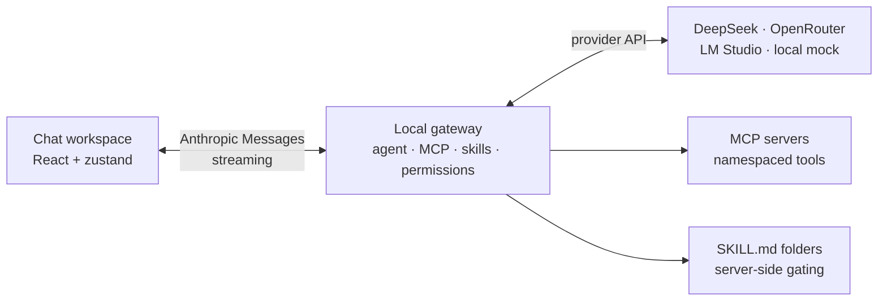

<div align="center">

# deepseek-ui

### Give DeepSeek an agent layer.

**MCP tools · Skills · Real permissions · A local-first gateway**

An open-source agent layer for DeepSeek, built to bring tool use and skills to a familiar chat workspace while keeping execution in a local gateway.

[Architecture](#architecture) · [Capabilities](#what-it-does) · [Setup](#getting-started) · [Status](#project-status) · [Roadmap](#roadmap)

[Open the animated project page](index.html)

</div>

---

## The idea

The browser stays the chat interface. A local gateway handles the work a browser cannot do by itself: spawning MCP stdio servers, accessing local files, and running an agent loop.



The official DeepSeek UI already supports a configurable API origin. The gateway is the seam between that browser UI and local capabilities.

## What it does

| Capability | How it works |
|---|---|
| **Agent loop** | Plans, calls tools, observes bounded results, and continues with an iteration cap. |
| **MCP hub** | Runs stdio servers in the gateway process. Tools are exposed with names such as `server__tool`. |
| **Skills loader** | Loads enabled skills from real `SKILL.md` folders, with progressive loading and server-side gating. |
| **Permissions** | Enforces allow, ask, or deny decisions in gateway code. |
| **Provider boundary** | DeepSeek is the production provider; a configurable base URL supports compatible routes. Local mock mode runs without network access or credentials. |
| **Chat workspace** | Model switcher plus persistent Skills, Plugins, MCP servers, and Connectors panels. |

MCP servers are configured in `deepseek-ui.config.json`. Enable a connected server in the workspace so the model receives only that server's namespaced tools. Connector entries become executable when backed by an MCP server with the same ID. Credentials are not stored in the browser.

Tool results are bounded and marked as untrusted evidence. MCP tools advertising `readOnlyHint` can run concurrently when the model emits independent calls. Provider usage data is forwarded through the Anthropic-compatible response.

<div align="center">

**Browser UI** → **Local gateway** → **Your tools and provider**

</div>

## Getting started

### Run the engine

```bash
npm install --include=dev
DEEPSEEK_API_KEY=your_key npm run dev
npm test
```

### Run the gateway and UI

In one terminal:

```bash
DEEPSEEK_API_KEY=your_key npm run gateway
```

In a second terminal:

```bash
cd ui
pnpm install
pnpm dev
```

Open [http://localhost:8090](http://localhost:8090). The UI development build points to the local gateway by default. Set `DEEPSEEK_UI_API_ORIGIN` to use another compatible API.

> **Windows install note:** If `NODE_ENV=production` is set globally, npm or pnpm may skip devDependencies. Set `NODE_ENV=development` when installing.

Configure MCP server `timeoutMs` and `retries` in `deepseek-ui.config.json`. The browser never executes MCP tools; the gateway process does.

## Project status

| Piece | Location | State |
|---|---|---|
| DeepSeek client with `reasoning_content` round-trip | `src/deepseek.ts` | Unit tested |
| Agent loop, iteration cap, output truncation | `src/agent.ts` | Not yet run against a live API |
| MCP hub (stdio), namespaced tools | `src/mcp.ts` | Not yet run against a live server |
| Skills loader | `src/skills.ts` | Unit tested |
| Permissions | `src/permissions.ts` | Unit tested |
| Terminal harness | `src/cli.ts` | Not yet run |
| Vendored official UI | `ui/` | Builds on Windows and is wired to the local gateway |
